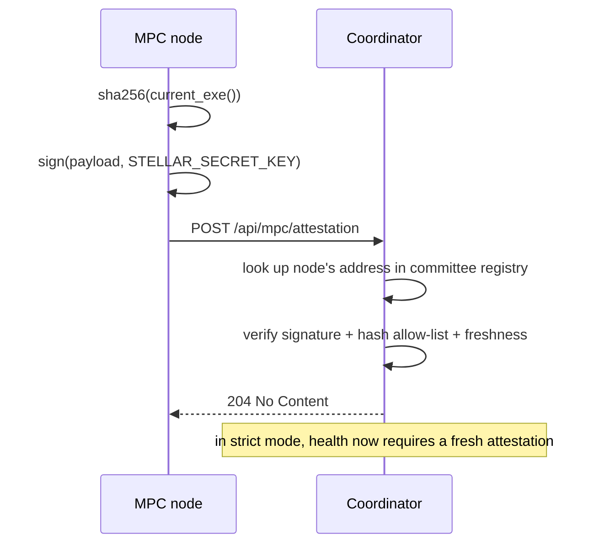

# Node Build-Provenance Attestation

Issue #587. SBOMs (`#16`) describe *what was built*; circuit provenance
(`scripts/generate-provenance.sh`) describes *how circuits were built*. This
feature closes the loop at runtime: **every MPC node attests which binary it
is actually running**, and the coordinator can refuse to trust unattested
peers.

This is the runtime half of the project's SLSA Level 3 aspiration. It does not
by itself make the build reproducible (that is the build system's job); it
makes the *deployed* artifact auditable and enforceable.

Implementation:

- Node: `services/node/src/attestation.rs`
- Coordinator: `services/coordinator/src/node_attestation.rs`

## Attestation content

At startup (and periodically thereafter) a node produces:

```json
{
  "node_id": 0,
  "binary_sha256": "…64 hex…",
  "binary_size": 18432000,
  "package_version": "0.1.0",
  "git_commit": "52d963b",
  "build_target": "x86_64-linux",
  "generated_at": 1770000000,
  "slsa_level": 3,
  "signer": "G…",
  "signature": "…128 hex…"
}
```

* `binary_sha256` is the SHA-256 of the node's own executable
  (`std::env::current_exe()`).
* The node signs a canonical payload with its **committee Stellar keypair**
  (`STELLAR_SECRET_KEY`). The exact payload is defined once and mirrored
  byte-for-byte in both crates:

  ```
  stellar-poker-attestation|<node_id>|<sha256>|<size>|<version>|<commit|->|<target>|<generated_at>|<slsa_level>|<signer>
  ```

* `slsa_level` is the node's claim (3 for a hardened build). The coordinator
  does not verify build hardening; it records the claim alongside the hash.

## Flow



## Coordinator policy

| Variable | Default | Meaning |
|---|---|---|
| `MPC_ATTESTATION_STRICT` | `false` | When true, a node is only healthy if it has a fresh, valid attestation. |
| `MPC_ATTESTATION_ACCEPTED_HASHES` | empty | Comma-separated SHA-256 allow-list. If set, an off-list binary is rejected even in non-strict mode. |
| `MPC_ATTESTATION_MAX_AGE_SECS` | `3600` | Reject/serve-stale after this long. |

Rejection reasons: the node has no registered committee identity, the signer
does not match that identity, the signature does not verify, the binary hash is
off the allow-list, or the attestation is stale.

## Strict mode refuses unattested peers

In strict mode the coordinator's health loop marks a node healthy only when it
is both reachable **and** has a current attestation. Because node selection
(`select_mpc_nodes`) only chooses healthy nodes, an unattested peer is never
handed committee work — it cannot join a session, and a session cannot be
dispatched to it. Operators rolling out a new node can therefore leave strict
mode off until the new binary begins attesting, then turn it on.

## Rolling it out

1. Compute the expected digest for the released binary:

   ```bash
   sha256sum target/release/mpc-node
   ```

2. Deploy with attestation reporting enabled (the node needs `COORDINATOR_URL`
   and `STELLAR_SECRET_KEY`):

   ```bash
   COORDINATOR_URL=http://coordinator:8080 \
   STELLAR_SECRET_KEY=S… \
   MPC_ATTESTATION_INTERVAL_SECS=300 \
   ./mpc-node
   ```

3. Inspect what the coordinator has seen:

   ```bash
   curl http://localhost:8080/api/mpc/attestation/status
   ```

4. Once every node reports the expected hash, enforce it:

   ```bash
   MPC_ATTESTATION_ACCEPTED_HASHES=<sha256>,<sha256>,<sha256> \
   MPC_ATTESTATION_STRICT=1 \
   coordinator
   ```

## Tests

The node tests cover the SHA-256 vector, canonical payload stability, signature
round-trip and secret-key parsing. The coordinator tests cover signature
verification, tampered payload rejection, unregistered nodes, allow-list
enforcement, and strict-mode freshness.
