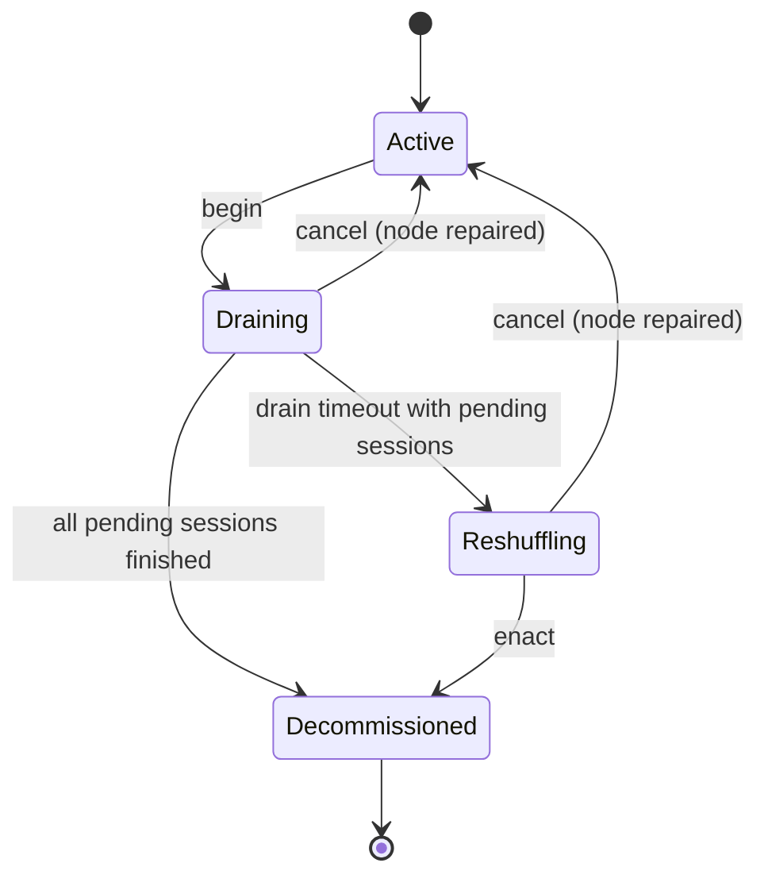

# Node Decommission & Secure Reshuffle

Issue #585. When an MPC committee member is decommissioned, ongoing privacy
must not leak and ongoing hands must not freeze. This documents the procedure
and the guarantees.

Implementation: `services/coordinator/src/node_decommission.rs`.
Status: `GET /api/mpc/decommission/status`.

## Why this is delicate

The committee is a 3-party REP3 secret-sharing scheme
([MPC Committee Resilience](mpc-committee-resilience.md)). A hand's deck exists
only as shares split across the three active nodes. Two rules follow:

1. A departing node's shares must **never** be copied to a replacement. Doing
   so would hand the replacement (and anyone who later compromises it) a piece
   of the old deal, breaking the "no single party, and no two colluding
   parties, ever see the deck" property for hands that already ran.
2. A replacement may only participate through **fresh shares from a new
   shuffle**, or by holding the *same* identity as the node it replaces (a
   warm standby provisioned ahead of time).

## Lifecycle



* **Active** — normal; the node may be assigned new sessions.
* **Draining** — `begin` stops new assignments. In-flight sessions are tracked
  until they complete.
* **Reshuffling** — the drain timed out; a replacement has been chosen and
  every pending session is scheduled to resume or abort.
* **Decommissioned** — the node is out of the committee.

## Path A — drain-and-wait (preferred)

The simplest and safest exit. `begin(node)` marks the node as draining; the
coordinator stops selecting it for new sessions (see
`DecommissionManager::filter_assignable`) but lets existing sessions run to
completion. When every pending session has completed the node exits with **no
reshuffle at all**.

```bash
# Start draining node 1
curl -X POST localhost:8080/api/mpc/decommission/begin \
     -H 'Content-Type: application/json' -d '{"node_id":"1"}'

# Watch the drain
curl localhost:8080/api/mpc/decommission/status
```

If all hands finish before `MPC_DECOMMISSION_DRAIN_TIMEOUT_SECS` (default
120 s), the node can be stopped with an empty pending set.

## Path B — secure reshuffle

If the drain window elapses with sessions still pending, fall back to a
reshuffle. The operator chooses a replacement and states whether it holds the
same REP3 party identity:

```bash
# Plan: replacement "3" is a warm standby with role 1's identity
curl -X POST localhost:8080/api/mpc/decommission/plan \
     -H 'Content-Type: application/json' \
     -d '{"node_id":"1","replacement_node":"3","identity_preserved":true}'

# Finalize
curl -X POST localhost:8080/api/mpc/decommission/enact \
     -H 'Content-Type: application/json' -d '{"node_id":"1"}'
```

For each pending session the plan returns a disposition:

| `identity_preserved` | Disposition | Meaning |
|---|---|---|
| `true` | `resume` | The replacement takes over the exact REP3 party role. No shares move; the session continues. |
| `false` | `abort` | The replacement has a different identity. The session is abandoned and must be **re-dealt from a fresh shuffle** on the new committee. |

The abort path is privacy-preserving by construction: the old shares are simply
discarded by their holders. Nothing about the old deck is transmitted anywhere.

### Warm standbys

The identity-preserving path is what `scripts/promote-mpc-standby.sh` and the
`standby` compose profile exist for: a standby launched from the *same*
`PARTY_CONFIG` already holds an identical share set, so it can take over a role
without a re-key ceremony. Set
`MPC_DECOMMISSION_REQUIRE_IDENTITY_STANDBY=1` to refuse the abort path
entirely and keep the node up rather than interrupt hands.

## Configuration

| Variable | Default | Meaning |
|---|---|---|
| `MPC_DECOMMISSION_DRAIN_TIMEOUT_SECS` | `120` | How long to wait before falling back to a reshuffle. |
| `MPC_DECOMMISSION_REQUIRE_IDENTITY_STANDBY` | `false` | When true, a reshuffle without an identity-equivalent standby is refused. |

## Tests

`node_decommission.rs` tests the whole state machine: draining refuses new
sessions while preserving pending ones, drain completes when sessions finish,
drain times out with pending sessions, identity-preserving reshuffle resumes,
identity-changing reshuffle aborts, planning before timeout is refused, strict
mode refuses a non-identity reshuffle, self-replacement is rejected, cancel
restores `Active`, and node filtering excludes draining nodes.
