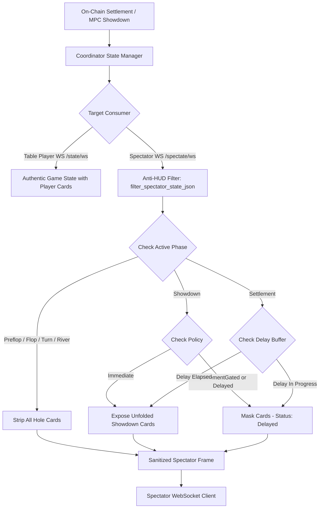

# Spectator Anti-HUD & Delayed Card Reveal Policy Specification (Issue #692)

## 1. Context & Threat Model

In online poker and decentralized gaming, live spectators watching a table via WebSocket or public queries can inadvertently (or maliciously) leak private information:

1. **Collusion & Ghosting**: An accomplice watching as an anonymous spectator could read real-time telemetry and feed insights or folded cards back to an active player at the table.
2. **Automated HUD Sniffing**: Third-party bots can scrape spectator endpoints to construct aggressive profiling stats (VPIP, PFR, 3-bet frequencies, showdown showdown distributions) in real time before the active hand concludes.
3. **Muck Leakage**: When a player loses at showdown without having called the final bet, or when a player folds, their cards should remain mucked. Instant card reveals compromise player strategy.

---

## 2. Policy Specification

StellPoker enforces an **Anti-HUD Delayed Reveal Policy** across all spectator connections (`/api/table/:table_id/spectate/ws` and `/api/table/:table_id/spectators`).

### 2.1 Street Masking Rule
- **Scope**: All active betting streets (`Preflop`, `Flop`, `Turn`, `River`, and dealing phases).
- **Rule**: Spectators **never** receive hole cards. Hole card arrays are masked to `null` or omitted entirely. Only the authenticated player's `/cards` endpoint serves individual decrypted hole cards.

### 2.2 Muck Rule
- **Rule**: Cards of folded players are **permanently hidden** from spectators under all policies.
- Even after showdown settlement, mucked cards are never sent to spectators.

### 2.3 Showdown Delay Policy Modes

| Policy Mode | Behavior | Use Case |
|-------------|----------|----------|
| `Immediate` | Hole cards revealed to spectators as soon as showdown is processed on-chain. | Casual, friendly, or tutorial tables. |
| `SettlementGated` | Hole cards remain masked during `Showdown` phase; revealed only once the table transitions to `Settlement`. | Standard cash tables (prevents in-flight front-running). |
| `DelayedSeconds` | Cards are revealed after settlement + a configured time buffer (default: **15 to 30 seconds**). | Competitive tables & anti-ghosting. |
| `DelayedLedgers` | Cards are revealed after settlement + `N` Stellar ledgers (e.g. 5 ledgers ~ 25 seconds). | On-chain deterministic delay policy. |
| `Hidden` | Hole cards are **never** revealed to spectators, even post-settlement. | High-stakes / private anti-HUD tables. |

---

## 3. Data Flow Architecture



---

## 4. Client Presentation (UI Indicators)

The sanitized JSON delivered to spectator streams includes an `anti_hud` status object:

```json
{
  "type": "game_state",
  "table_id": 42,
  "phase": "Showdown",
  "anti_hud": {
    "enabled": true,
    "policy": "DelayedSeconds",
    "cards_delayed": true,
    "delay_remaining_seconds": 15
  }
}
```

The frontend spectator view (`app/src/components/SpectatorTable.tsx` and `app/src/lib/spectator.ts`) displays an **"Anti-HUD Protected (Cards Delayed)"** badge to reassure players that spectators cannot ghost their hands.

---

## 5. Testing & Verification

- **Coordinator Filter Tests**: `services/coordinator/src/spectators.rs`
- **Frontend Observer Mode Tests**: `app/src/__tests__/spectator-anti-hud.test.ts`
