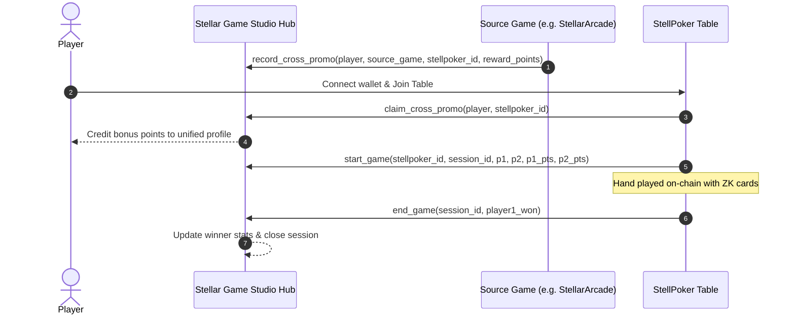

# Stellar Game Studio Game Hub Integration (Issue #693)

## Overview

StellPoker integrates directly with the **Stellar Game Studio Game Hub** ecosystem to provide:
1. **Cross-Promotion**: Shared discovery of StellPoker across the Stellar Game Studio arcade catalog with referral tracking and bonus reward points.
2. **Shared Player Identity**: Players can link their on-chain wallet addresses to their unified Stellar Game Studio handle (`studio_id`), carrying progress and statistics across titles.
3. **Session Lifecycle Synchronization**: Automatic hand and session tracking via the Game Hub smart contract standard (`start_game` and `end_game`).

## Contract Addresses & Interface

- **Production/Testnet Game Hub Address**: `CB4VZAT2U3UC6XFK3N23SKRF2NDCMP3QHJYMCHHFMZO7MRQO6DQ2EMYG`
- **Contract Source**: `contracts/game-hub/`
- **Poker Table Adapter**: `contracts/poker-table/src/game_hub.rs`

### Game Hub Interface Specification

```rust
pub trait StellarGameStudioHub {
    /// Initialize or update a game session (called on new hand start)
    fn start_game(
        env: Env,
        game_id: Address,
        session_id: u32,
        player1: Address,
        player2: Address,
        player1_points: i128,
        player2_points: i128,
    );

    /// Settle a game session and award winner points
    fn end_game(env: Env, session_id: u32, player1_won: bool);

    /// Register a game in the Game Studio catalog for cross-promotion
    fn register_game(
        env: Env,
        caller: Address,
        game_id: Address,
        name: soroban_sdk::String,
        metadata_uri: soroban_sdk::String,
    );

    /// Link a player's on-chain address with their Stellar Game Studio handle
    fn link_player(env: Env, player: Address, studio_id: soroban_sdk::String);

    /// Record a cross-promotion referral from another game
    fn record_cross_promo(
        env: Env,
        caller: Address,
        player: Address,
        source_game: Address,
        target_game: Address,
        reward_points: i128,
    );

    /// Claim cross-promotion bonus points upon joining StellPoker
    fn claim_cross_promo(env: Env, player: Address, target_game: Address) -> i128;
}
```

## Shared Player Identity

Players authenticate on Stellar Game Studio using their profile or session handle. When connecting their wallet to StellPoker:
1. `link_player(player, studio_id)` binds the wallet address to their Game Studio profile.
2. `get_player_profile(player)` returns their cross-game stats:
   - `games_played`: Lifetime games across hub titles.
   - `games_won`: Lifetime victories.
   - `total_points`: Cumulative points/rewards across all studio games.

## Cross-Promotion Flow



## Integration Tests

End-to-end integration tests are located in:
- `contracts/poker-table/tests/game_hub_integration_test.rs`
- `contracts/game-hub/src/lib.rs`

Run tests locally:
```bash
cargo test -p game-hub
cargo test -p poker-table --test game_hub_integration_test
```
